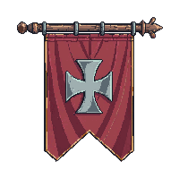

<h1 align="center">  🌸 Greetings Travellers </h1>

```csharp
matrix@root:~$ whoami                                                

   \  |     \  __ __|   _ \  _ _| \ \  / 
  |\/ |    _ \    |    |   |   |   \  /                                      
  |   |   ___ \   |    __ <    |      \                                      |>>>
 _|  _| _/    _\ _|   _| \_\ ___|  _/\_\                                     |
                                                                         _  _|_  _
    Identity    : 3L3V3N                                                |;|_|;|_|;|
    Domain      : Cybersecurity                                         \\.    .  /
    Interests   : DFIR | Linux                                           \\:  .  /
                  Malware Analysis                                        ||:   |
                  Semi-Conductor Eng                                      ||:.  |
                  Networking | Hardware                                   ||:  .|
    Languages   : C | Python | Bash                                       ||:   |       \,/
    Environment : Linux Systems                                           ||: , |            /`\
                                                                          ||:   |
                                                                          ||: . |
                                           __                            _||_   |
     ____--`~    '--~~__            __ ----~    ~`---,              ___   ||:   |
-~--~                   ~---__ ,--~'                  ~~----_____-~'   `~----~~--~----

```


<h1 align="center" > 🍄Tool Stack  
<br>
<p align="center">
  
  
  
  
  
  
</p>

<p align="center">
  
  
  
  
  
  
</p>
<br>
<br>
<br>



<p align="left" > 🌼CTFs </p>

   
[](https://github.com/matrix-7337/OverThewire-CTF)
[](https://play.picoctf.org/users/matrix-7337)

[](https://ctflearn.com/user/matrix-7337)
[](https://tryhackme.com/p/matrix7337)
[](https://ctftime.org/user/260937)

<br>

 ###
 
<a href="https://discord.whispergate.org/" target="_blank">
  
</a>
